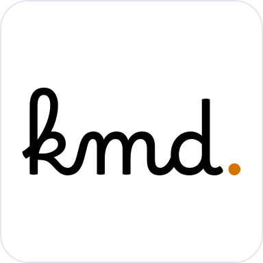
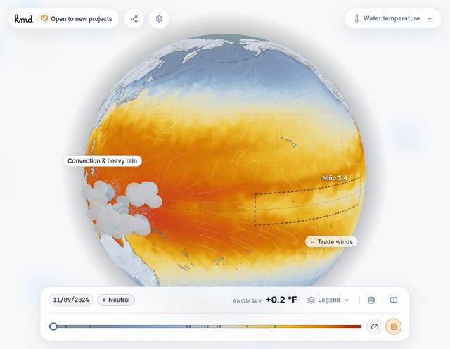

  

  
<strong>Planetary, Oceanographic & Geospatial Interactive Visualizations</strong>

  

    
    
    
    
  

   

  

---

### About KMD Labs

**KMD (`kmd-labs`)** crafts zero-friction, scientific data visualizations and interactive web applications for planetary, climate, oceanographic, and satellite datasets.

The team grew out of **Viadrus AI**, the 1st Polish team to win the European final of the **11th CASSINI Hackathon** organized by the European Union Agency for the Space Programme (**EUSPA**). Our winning solution used satellite earth observation data to detect leaks in municipal water supply networks.

---

### 🌐 Live Observatories & Core Repositories

| Observatory | Live Demo | Repository | Description |
| :--- | :--- | :--- | :--- |
| **Super El Niño** | [Live App ↗](https://kmd-labs.github.io/el-nino/) | [`kmd-labs/el-nino`](https://github.com/kmd-labs/el-nino) | Interactive 3D WebGL globe visualizing ENSO cycles, Walker Circulation, thermocline dynamics, and live NOAA OISST telemetry. |
| **Baltic Watershed** | [Live App ↗](https://kmd-labs.github.io/watershed/) | [`kmd-labs/watershed`](https://github.com/kmd-labs/watershed) | 3D drainage basin model tracking riverine nitrogen & phosphorus loads and historical Baltic Sea dead zones (HELCOM / EMODnet). |
| **Golfstrom / AMOC** | [Live App ↗](https://kmd-labs.github.io/golfstrom/) | [`kmd-labs/golfstrom`](https://github.com/kmd-labs/golfstrom) | Atlantic Meridional Overturning Circulation & Gulf Stream velocity streamlines, ocean dynamics, and climate tipping points. |
| **KMD Design System** | [Repository ↗](https://github.com/kmd-labs/design-system) | [`kmd-labs/design-system`](https://github.com/kmd-labs/design-system) | Unified light-theme tokens, Angular UI primitives, and zero-friction CLI scaffolder for scientific visualization applications. |

---

### 🛠️ Architecture & Technology

- **Framework & Runtimes:** Angular 21 (standalone components, signals), TypeScript 5.9, Vite / esbuild
- **3D & Graphics:** Three.js, WebGL Shaders, D3-Geo, Canvas 2D telemetry overlays
- **Design Tokens:** Unified Light Theme design system (`@kmd/design-system`), glassmorphic HUD panels, Inter typography
- **Open Scientific Data:** NOAA (OISST v2.1), Copernicus Marine, EMODnet Chemistry, HELCOM, Open-Meteo

---

### 📬 Get in Touch

Have complex planetary, satellite, or environmental data that needs to be visualized, or looking to collaborate?

- 🌐 **Landing Page:** [https://kmd-labs.org/](https://kmd-labs.org/)
- ✉️ **Direct Inquiry:** [hello@kmd-labs.org](mailto:hello@kmd-labs.org?subject=Project%20Inquiry%20%C2%B7%20KMD%20Labs&body=Hello%20KMD%20Labs%20team,%0A%0AI%20would%20like%20to%20discuss%20an%20interactive%20data%20visualization%20or%20geospatial%20application%20project.%0A%0ABest%20regards,)
- 💼 **LinkedIn:** [linkedin.com/company/kmd-lab](https://www.linkedin.com/company/kmd-lab)
